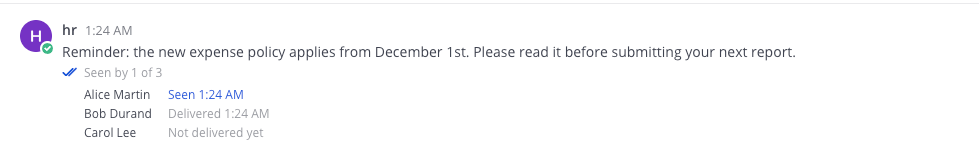
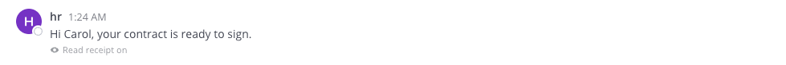

# Read Receipts for Mattermost

Sent, delivered and seen status on Mattermost messages, with the detail per recipient. Works on every edition, including the free Team Edition.



Recipients see that the message is tracked:



## Features

- Sent, Delivered and Seen ticks under your own messages, updated live.
- Click the ticks to see every recipient with the time they received and saw the message.
- Direct messages and group messages, public and private channels optional.
- You choose whose messages are tracked: by username, by role, or everyone (`system_user`).
- Recipients see a small "Read receipt on" mark, so nobody is tracked without knowing.
- Only the sender can read the receipts of their messages.
- Mobile apps count as seen through the channel's last viewed time.
- Receipts expire after a configurable number of days.

## Statuses

| Status | Meaning |
|---|---|
| Sent | The message is stored. |
| Delivered | The recipient had a Mattermost client connected (web, desktop or mobile) after the message was sent. |
| Seen | The recipient opened the conversation with the window in focus after the message was sent. Mobile apps count through the channel's last viewed time, checked every 30 s. |

None of these proves the text was read.

## Requirements

- Mattermost 10.0 or later, any edition.
- Linux amd64 or arm64 server.
- Single node. High Availability clusters are not supported yet (see Limitations).

## Installation

Download the bundle from the [releases](https://github.com/Morraycage/mattermost-plugin-read-receipts/releases), then either:

- System Console > Plugins > Plugin Management > Upload Plugin (plugin uploads must be enabled), or
- with mmctl:

```
mmctl plugin add com.github.morraycage.read-receipts-<version>.tar.gz
mmctl plugin enable com.github.morraycage.read-receipts
```

## Configuration

System Console > Plugins > Read Receipts:

| Setting | Default | |
|---|---|---|
| Senders (usernames) | empty | Comma-separated usernames whose messages are tracked. |
| Senders (roles) | empty | Comma-separated roles whose members' messages are tracked. `system_user` tracks everyone. |
| Direct messages | on | Track direct messages. |
| Group messages | on | Track group messages. |
| Public and private channels | off | Track channel posts. |
| Maximum recipients | 50 | Larger conversations are not tracked. |
| Retention (days) | 30 | Receipts are deleted after this. |
| Tell recipients | on | Show "Read receipt on" under tracked messages. |

Nobody is tracked until you list senders or roles. Bots are never tracked.

## Usage

Send a message as a tracked sender. Under it:

- one grey tick: sent;
- two grey ticks: delivered to at least one recipient;
- two blue ticks: seen, with "Seen by N of M" in groups.

Click the line to open the list of recipients with their times.

## Troubleshooting

- **No ticks under my messages**: check that your username or one of your roles is in the settings, and that the conversation type is enabled. Only messages sent after the plugin was enabled are tracked.
- **Stuck on Delivered on mobile**: the mobile app does not run plugin code; the seen status comes from a check every 30 s of the channel's last viewed time.
- **Large groups not tracked**: raise Maximum recipients.
- **Logs**: the plugin logs its configuration when it loads and every storage error. Look for `com.github.morraycage.read-receipts` in the server log.

## How it works

- `MessageWillBePosted` marks tracked posts with the `read_receipt` prop, so the webapp knows a post is tracked without a request.
- `MessageHasBeenPosted` stores the receipt in the plugin KV store (`r_<post id>`, expiring) and a short pending list per recipient (`p_<user id>`).
- Delivered: `OnWebSocketConnect` for that recipient, or a live connection at posting time.
- Seen: the webapp posts `/api/v1/viewed` when the user is on a channel with the window focused. A 30 s sweep covers clients without the webapp by comparing the channel's `LastViewedAt`.
- `GET /api/v1/receipts?post_ids=` only returns receipts of the caller's own posts.

## Limitations

- Single node only: state changes are serialised by an in-process lock.
- Messages sent before the plugin was enabled have no receipt.

## Development

Needs Go 1.22+ and Node 20+.

```
make            # dist/com.github.morraycage.read-receipts-<version>.tar.gz
```

`test/compose.yml` starts a throwaway Mattermost on http://localhost:8065. `test/e2e.mjs` creates test users, installs the bundle and checks every status:

```
docker compose -p rrdev -f test/compose.yml up -d
node test/e2e.mjs dist/com.github.morraycage.read-receipts-<version>.tar.gz
docker compose -p rrdev -f test/compose.yml down -v
```

Releases are built by GitHub Actions when a `vX.Y.Z` tag is pushed.

## Support

Bugs and questions: [GitHub issues](https://github.com/Morraycage/mattermost-plugin-read-receipts/issues), or `@morraycage` on the [Mattermost Community server](https://community.mattermost.com).

## License

MIT
